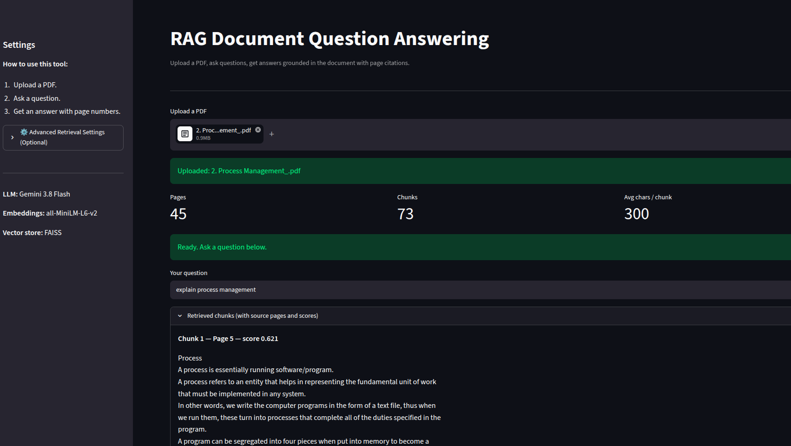

```markdown
# RAG Document Question Answering

A Retrieval-Augmented Generation (RAG) app that answers questions about a PDF using **Gemini 3.8 Flash**, with **page-level source citations** and a **hallucination guardrail**.

Upload a PDF, ask a question, get an answer grounded **only** in the document, and see exactly which pages the answer came from.



**Live App:** [rag-document-app.streamlit.app](https://rag-document-app-7gdkmcheoabnnkmmfykscu.streamlit.app)

## Features

- **PDF ingestion** — extracts text page by page with PyPDF2
- **Page-aware chunking** — every chunk remembers which page it came from, so answers can cite sources
- **Sentence-Transformers embeddings** — `all-MiniLM-L6-v2` for fast, high-quality vector search
- **FAISS vector store** — in-memory similarity search
- **Gemini 3.8 Flash** — state-of-the-art LLM for accurate, reasoned answers (with automatic retry on API limits)
- **Similarity threshold guardrail** — if the retrieved context isn't relevant enough, the app refuses to answer instead of hallucinating
- **Tunable retrieval** — chunk size, overlap, top-K, and threshold exposed in an "Advanced Settings" menu

## Tech Stack

`Python` · `Streamlit` · `PyPDF2` · `sentence-transformers` · `FAISS` · `Gemini API` · `Google GenAI SDK`

## How It Works

1. Extract text page by page from the uploaded PDF
2. Chunk each page (configurable size and overlap), tagging each chunk with its source page
3. Embed chunks with Sentence-Transformers
4. Store vectors in FAISS
5. User asks a question
6. Embed the question and retrieve top-K similar chunks
7. **Apply similarity threshold** — if the best chunk is too weak, return "I don't know"
8. Build prompt with page-tagged context
9. Gemini generates the answer using *only* the retrieved context
10. Return the answer with source page numbers

## Run Locally

### 1. Get a Gemini API Key
Go to [Google AI Studio](https://aistudio.google.com/apikey) and create a free API key.

### 2. Install Python dependencies
```bash
python3 -m venv .venv
source .venv/bin/activate
pip install -r requirements.txt
```

### 3. Set up your environment
Create a `.env` file in the root directory and add your key:
```
GEMINI_API_KEY=your_api_key_here
```

### 4. Run the app
```bash
streamlit run app.py
```
Open the URL that Streamlit prints (usually `http://localhost:8501`).

## Usage
1. Upload any PDF
2. Ask a question
3. Read the answer and check the source pages below it

## Design Decisions

**Why page-aware chunking?** Plain chunking loses source information. By tagging each chunk with its page, answers can cite sources — critical for real document assistants (contracts, papers, reports).

**Why Gemini 3.8 Flash?** It provides a great balance of speed, cost, and reasoning ability. It reliably follows instructions to cite pages and refuse to answer when context is missing. The app includes automatic retry logic to handle temporary API rate limits.

**Why a similarity threshold?** RAG systems are prone to hallucination when the retriever returns irrelevant chunks. By refusing to call the LLM when the best similarity score is too low, we guarantee the system doesn't make things up.

**Why FAISS?** Fast, in-memory similarity search with no external service. Perfect for a single-document Q&A use case.

## Attribution
Initial pipeline structure based on a Marvellous Infosystems RAG course. Independently extended with:
- Page-aware chunking and source citations
- Gemini API integration (migrated from local Ollama)
- Similarity threshold guardrail against hallucination
- Retry logic for API rate limits
- Clean, user-friendly Streamlit UI

## License
MIT
```

After pasting and saving (`Ctrl+S`), run these three commands in your terminal:

```bash
git add README.md
git commit -m "Update README for Gemini 3.8 and new features"
git push
```